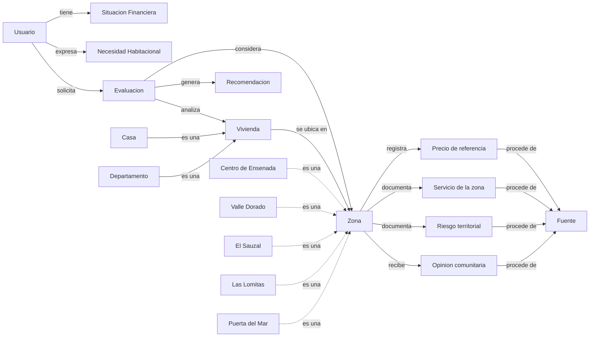

# Ontología del dominio: Asesoría para decidir entre rentar o comprar vivienda

**Proyecto:** Sistema Experto de Asesoría para la Renta o Compra de Vivienda en Ensenada, Baja California  
**Materia:** Programación Lógica

## Diagrama de clases y relaciones (Mermaid)

## Descripción de los conceptos

La ontología organiza los conceptos necesarios para el funcionamiento del Sistema Experto de Asesoría para la Renta o Compra de Vivienda en Ensenada.

Las clases principales representan al usuario, su situación financiera, las viviendas, las zonas de la ciudad y los resultados de las evaluaciones.

La clase Vivienda presenta una jerarquía de especialización, ya que Casa y Departamento son tipos de vivienda.

Las zonas Centro, Valle Dorado, El Sauzal, Las Lomitas y Puerta del Mar se representan como instancias de la clase Zona.

Los precios de referencia se mantienen separados de las viviendas individuales, debido a que los valores recopilados durante la investigación no necesariamente representan el costo de una propiedad específica.

Asimismo, las opiniones comunitarias se representan de manera independiente a los riesgos territoriales documentados, evitando considerar comentarios personales como estadísticas oficiales de seguridad.

Las conexiones del diagrama permiten identificar cómo se relacionan los conceptos y qué información deberá utilizarse posteriormente durante el proceso de evaluación.

La ontología servirá como fundamento para organizar la base de conocimiento y facilitar la implementación de las reglas lógicas del Sistema Experto.