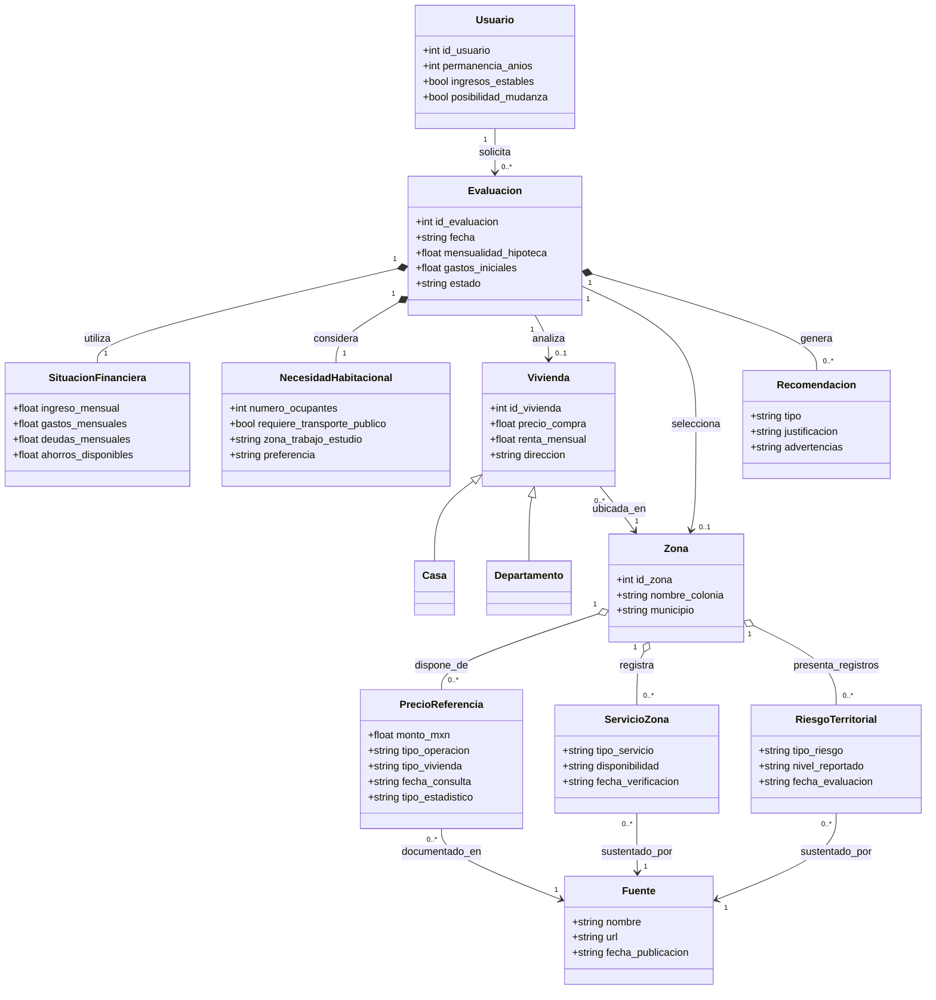

# Ontología del dominio: Asesoría para decidir entre rentar o comprar vivienda

**Proyecto:** Sistema Experto de Asesoría para la Renta o Compra de Vivienda en Ensenada, Baja California  
**Materia:** Programación Lógica

## Diagrama de clases y relaciones (Mermaid)

## Descripción de los conceptos

| Clase | Función en el dominio |
| --- | --- |
| **Usuario** | Persona que solicita orientación. |
| **SituacionFinanciera** | Información económica disponible para una evaluación. |
| **NecesidadHabitacional** | Preferencias y necesidades personales del usuario. |
| **Vivienda** | Inmueble que se desea analizar, cuando se dispone de uno concreto. |
| **Casa**, **Departamento** | Especializaciones («es-un») de Vivienda. |
| **Zona** | Colonia o sector de Ensenada donde se ubica la vivienda. |
| **PrecioReferencia** | Información agregada del mercado; no equivale al precio de una vivienda específica. |
| **ServicioZona** | Registro documentado sobre disponibilidad de un servicio en una zona. |
| **RiesgoTerritorial** | Registro documentado de un riesgo, sin presumir que toda la zona tiene las mismas condiciones. |
| **Fuente** | Procedencia verificable de información territorial y de precios. |
| **Evaluacion** | Vincula datos y alternativas para su análisis. |
| **Recomendacion** | Posible conclusión de la evaluación, con explicación y advertencias. |

## Precisiones de modelado

- La relación **Casa/Departamento → Vivienda** es una **generalización o especialización**, no un paso del algoritmo.
- Una evaluación puede analizar una vivienda específica (`0..1`) o una zona (`0..1`) sin propiedad identificada. En la implementación se debe exigir información suficiente para emitir una recomendación.
- Los precios de referencia deben conservar su **fecha, tipo de operación y fuente**. La falta de un dato no implica que sea cero.
- **ServicioZona** y **RiesgoTerritorial** son registros de información; la ausencia de registros **no prueba** la ausencia de riesgos o la disponibilidad de servicios.
- Esta es una **ontología conceptual expresada como diagrama de clases Mermaid**; las reglas de producción SI–ENTONCES y su ejecución se documentan por separado en la base de conocimiento y en el prototipo Python.

## Texto sugerido para el reporte

**Figura 1. Ontología del Sistema Experto de Asesoría para la Renta o Compra de Vivienda en Ensenada.**

La ontología representa los principales conceptos que intervienen en la decisión de rentar o comprar una vivienda, incluyendo los datos económicos y personales del usuario, las características de los inmuebles, la información territorial y las recomendaciones generadas. La clase `Vivienda` presenta una jerarquía de especialización mediante `Casa` y `Departamento`. Las demás clases se relacionan mediante asociaciones que permiten identificar cómo se utiliza la información durante una evaluación. También se incluyen relaciones con fuentes documentales para identificar la procedencia de los precios de referencia, servicios y riesgos territoriales.
